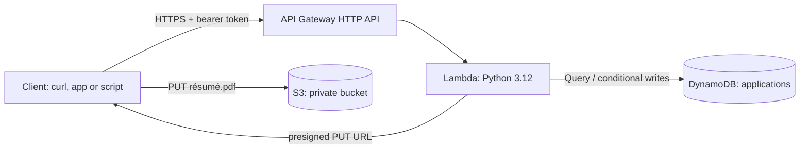

# Serverless Job Application Tracker

A small REST API for tracking job applications, built on AWS serverless services: **API Gateway (HTTP API) → Lambda (Python 3.12) → DynamoDB**, with résumé and cover-letter uploads going straight to **S3** through presigned URLs.

Job searches usually live in spreadsheets. This project turns that into a proper API and uses it to exercise DynamoDB table design, least-privilege IAM and infrastructure as code.

**What was interesting:**
- **Designing the table around the queries.** DynamoDB has no ad-hoc queries, so I designed the indexes around how the data is read.
- **Making concurrent edits safe without locks.** Two clients editing the same application can't overwrite each other.
- **Keeping file uploads out of the Lambda function.** Files go directly from the client to S3.


## Architecture



| Resource | Notes |
|---|---|
| API Gateway HTTP API | 7 routes, CORS enabled |
| Lambda | One function, no third-party runtime dependencies, arm64 |
| DynamoDB | On-demand billing, encryption at rest, point-in-time recovery, two GSIs |
| S3 | Private bucket, all public access blocked, server-side encryption |
| IAM | CRUD on the one table, and `s3:PutObject` only under `applications/*` |

## API

All requests need `Authorization: Bearer <ApiToken>`.

| Method | Path | Purpose |
|---|---|---|
| `POST` | `/applications` | Create (`company`, `role`, `appliedOn` required; `status`, `url`, `notes` optional) |
| `GET` | `/applications?status=&limit=&cursor=` | List newest first, optionally by status, with cursor pagination |
| `GET` | `/applications/{id}` | Read one |
| `PATCH` | `/applications/{id}` | Update `status`, `notes`, `url` or `role`; must include the `version` you last read |
| `DELETE` | `/applications/{id}` | Delete |
| `POST` | `/applications/{id}/attachments` | Get a 5-minute presigned URL to upload a PDF |
| `GET` | `/stats` | Counts by status |

Statuses: `applied`, `interviewing`, `offer`, `rejected`, `withdrawn`. Errors share one shape: `{"error": {"code", "message", "fields"?}}`.

## Run the tests locally (no AWS account needed)

DynamoDB and S3 are mocked with [moto](https://github.com/getmoto/moto), so the tests run entirely offline. You need Python 3.12 or newer.

```bash
git clone https://github.com/Riya-086/serverless-job-tracker.git
cd serverless-job-tracker
python -m venv .venv
source .venv/bin/activate          # Windows: .venv\Scripts\activate
pip install -r requirements-dev.txt
pytest                              # 11 tests
cfn-lint template.yaml              # validates the infrastructure template
```

## Deploy to AWS

Prerequisites:
- An AWS account
- The [AWS CLI](https://docs.aws.amazon.com/cli/latest/userguide/getting-started-install.html), configured with `aws configure`
- The [AWS SAM CLI](https://docs.aws.amazon.com/serverless-application-model/latest/developerguide/install-sam-cli.html)

Usage stays within the AWS Free Tier for personal use.

```bash
sam build
sam deploy --guided        # stack name: job-tracker; ApiToken: a long random string
```

SAM prints the `ApiUrl` when it finishes. To try it:

```bash
API=https://xxxx.execute-api.us-east-1.amazonaws.com
TOKEN=your-api-token

curl -s -X POST "$API/applications" -H "Authorization: Bearer $TOKEN" -H "Content-Type: application/json" \
  -d '{"company":"Acme","role":"Backend Engineer","appliedOn":"2026-10-01"}'

curl -s "$API/applications?status=applied" -H "Authorization: Bearer $TOKEN"

# Upload a résumé: ask for a presigned URL, then PUT the file straight to S3
curl -s -X POST "$API/applications/<id>/attachments" -H "Authorization: Bearer $TOKEN" \
  -H "Content-Type: application/json" -d '{"filename":"resume.pdf"}'
curl -X PUT "<uploadUrl>" -H "Content-Type: application/pdf" --upload-file resume.pdf
```

To remove everything: `sam delete --stack-name job-tracker`. Empty the S3 bucket first if it contains uploads.

## CI/CD

- **CI** (`.github/workflows/ci.yml`) runs on every push and pull request. It runs the Ruff lint and format check, all tests, and `cfn-lint` on the template.
- **Continuous deployment** (`.github/workflows/deploy.yml`) is a manual, one-click deploy using GitHub's OIDC integration, so no long-lived AWS keys are stored in GitHub. To enable it in a repository:
  1. In AWS IAM, add GitHub as an OIDC identity provider (`token.actions.githubusercontent.com`).
  2. Create a role that trusts this repository and can deploy CloudFormation, Lambda, API Gateway, DynamoDB, S3 and IAM roles.
  3. In the repository settings, add these secrets:
     - `AWS_DEPLOY_ROLE_ARN`
     - `API_TOKEN`
  4. Optionally, add the variable `AWS_REGION`.
  5. Run **Actions → Deploy to AWS → Run workflow**.

## Design decisions

**Indexes designed around the access patterns.** The two list views are "all applications, newest first" and "applications in one status, newest first". Each one is a GSI query (`byDate` on a constant `entity` key, `byStatus` on `status`), sorted by `appliedOn`. No `Scan` is used anywhere.
- Tradeoff: a constant partition key can become a hot partition at very large scale. That's fine for a personal tracker, but a multi-user version would put the user ID in the key.

**Optimistic concurrency instead of locks.** Every item has a `version`, and an update only succeeds if the client sends the version it last read (`ConditionExpression`). A stale write returns `409` with the current version instead of silently overwriting someone else's change.

**Presigned uploads.** The client uploads directly to S3, so files never pass through Lambda. That avoids API Gateway's payload limit and Lambda execution time. The presigned URL is limited to one key, PDF content type and five minutes.

**Least privilege.** The function can only touch its own table and write under `applications/` in its own bucket.

**No runtime dependencies.** Validation is hand-written instead of using a library. That keeps the deployment package tiny and cold starts fast.

**Constant-time token comparison** (`hmac.compare_digest`) avoids leaking information through timing.

## Limitations and next steps

- **Single user.** There is one shared bearer token. The natural next step is Amazon Cognito with a JWT authorizer, plus a `userId` partition key.
- **Token storage.** The token sits in a Lambda environment variable. AWS Secrets Manager would be better for a shared deployment.
- **Uploads aren't confirmed.** Attachment keys are recorded when the URL is issued, not when the upload completes. An S3 event notification could confirm them.
